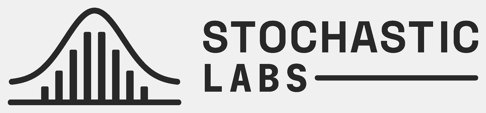

# Stochastic Labs v2 — 3D-print version (Onshape)

A print-tuned version of the v2 primary logo, for **debossing** (recessing) into 3D-printed parts with a **0.2 mm nozzle** at about **20–40 mm wide**.



## Files

| File | Use |
|---|---|
| `stochastic-labs-v2-print.dxf` | Import into an Onshape sketch. Units: mm. Drawn 30 mm wide × 6.2 mm tall. |
| `stochastic-labs-v2-print.svg` | The same outlines as an SVG, for checking or for other tools |
| `preview.png` | Picture of the outlines |
| `build_print.py` | Regenerates the files from the fonts (see the end of this page) |

Every closed outline in the DXF is one pocket. The text and strokes are already converted to filled shapes, so there is nothing to clean up after import.

## Changes from the screen logo

- **"STOCHASTIC" in all caps.** Every letter is the full 2.0 mm height at 30 mm wide, instead of lowercase letters at 1.5 mm. This removes the thin spots inside a, s and the i's dot.
- Extra space between **T and I**, which nearly touched at the top.
- **LABS** in JetBrains Mono ExtraBold, about twice its screen size, with tighter letter spacing.
- Removed the dashed line at the mean and the dot at the peak.
- **8 bars instead of 12**, each 0.46 mm wide with 0.44 mm gaps at 30 mm. The bars join the baseline, making one pocket.
- The curve is lifted so there is at least a 0.4 mm wall between it and the bars and baseline. It is 0.36 mm wide and still follows a normal distribution with mean 10.5 and standard deviation 2.96.

## Step 1: Import into Onshape

1. In your Part Studio, create a **sketch** on the face where the logo goes.
2. Click **Insert DXF or DWG** in the sketch toolbar.
3. At the bottom of the dialog, set **Units: Millimeter** *before* choosing the file (the dialog closes as soon as you pick one).
4. Click **Import** and choose `stochastic-labs-v2-print.dxf`. It lands centered on the sketch origin unless you tick *Use file origin position*.
5. **Size it.** Add one dimension, such as the overall width. The first dimension scales the whole sketch. Move it into place with the sketch transform tools if needed.
6. Close the sketch.

## Step 2: Cut the deboss

1. Start an **Extrude** and choose **Remove**.
2. Select **all** the logo regions: every letter, the bars and baseline, the curve and the rule. Don't select the small islands inside letters (the centers of O, A and B).
3. Set the depth to **0.4–0.6 mm**, which is 2–3 layers at 0.2 mm or 4–6 layers at 0.1 mm. Deeper cuts don't read better and make thin walls more fragile.
4. Merge with the part, then export the part as STL or 3MF.

## Step 3: Slice and print (0.2 mm nozzle)

**Placement and orientation**
- The best place is an **upward-facing top surface**. Every detail of the logo then lies flat in the XY plane, where the printer is most precise.
- On a vertical wall, sharpness depends on layer height, so use **0.08–0.12 mm** layers for at least that part of the print (variable layer height).
- Avoid the bottom face (bed side). The recess would need bridging and the detail gets lost.

**Slicer settings**
- Use a slicer with **variable-width walls**: Arachne in PrusaSlicer, OrcaSlicer or Bambu Studio, or Cura 5+. It keeps the thin walls between pockets instead of dropping them.
- Line width: about **0.22 mm**.
- For a top-surface deboss, set **top layers to cover the pocket floor**, at least 3 layers, so the bottom of the logo is solid.
- **Ironing** on the top surface (optional) makes the logo stand out sharply against a smooth face. Set ironing to "topmost surface only" so it doesn't fill the pockets.
- Printing slower on the top layers (about 30–50 mm/s outer walls) gives cleaner edges.

**Size guide**

| Logo width | What to expect |
|---|---|
| 40 mm | Everything crisp |
| 30 mm (as drawn) | Mark crisp; text clean except the openings in the three S's |
| 25 mm | Text softens; the mark still holds up |
| Under 25 mm | Use the mark without the text |

At 30 mm: narrowest groove 0.30 mm (text strokes) and 0.36 mm (mark). Narrowest wall 0.40 mm in the mark. The text's narrowest walls are 0.25–0.35 mm, at the S openings. The tiny point at the top of each A's counter always fills in; that's expected and the letters still read as A.

**Tips**
- **Make a test coupon first.** Print a small flat tile with the logo at your target size; it takes a few minutes and shows how your printer handles the S openings.
- To make the logo pop on a single-color part, run a fine paint pen or acrylic paint over the recess and wipe the surface flat.

## Regenerating

You need Python 3 with `numpy` and `fonttools` (plus `matplotlib`, `scikit-image`, `scipy` and `Pillow` for `--check`), and the two font files, both free on Google Fonts: `SpaceGrotesk-Bold.ttf` and `JetBrainsMono-ExtraBold.ttf`.

```
FONT_DIR=path/to/fonts python3 build_print.py OUTPUT_DIR          # writes the DXF and SVG
FONT_DIR=path/to/fonts python3 build_print.py OUTPUT_DIR --check  # also writes check.png marking thin spots
```

Sizes, letter spacing, bar count, wall and groove widths are parameters at the top of the script.
